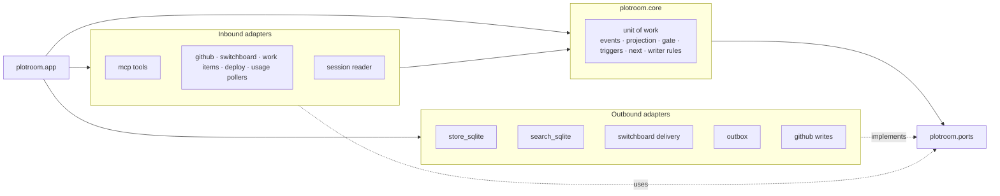
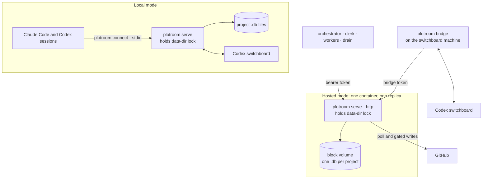
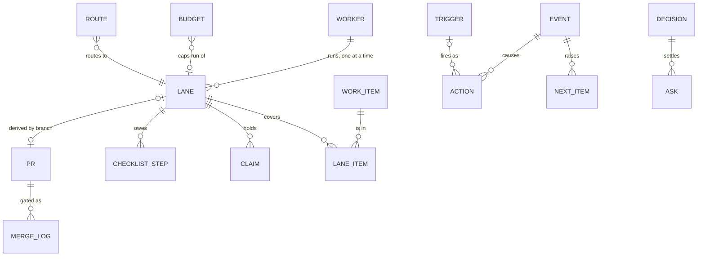

# Architecture Spine — Orchestration control plane

## Design Paradigm

Hexagonal (ports and adapters) around an append-only event log. The **core** holds every rule: the ledger, the GitHub projection, the merge gate, the trigger engine, next items, the writer-rule table and token-budgeted rendering. **Ports** are the interfaces the core needs. **Adapters** implement them. Inbound adapters turn the outside world into events. Outbound adapters carry the core's committed actions out. Local and hosted modes run the same core and differ only in which adapters the composition root wires.

| Layer | Package | Holds |
| --- | --- | --- |
| Core | `plotroom.core` | Entities, event-kind registry, unit of work, projection, gate, triggers, next items, writer rules, rendering |
| Ports | `plotroom.ports` | `typing.Protocol` interfaces: `Store`, `Transaction`, `Search`, `Embedder`, `WorkerChannel`, `GitHub`, `WorkItemSource`, `DeployStatus`, `UsageMeter`, `SessionReader`, `Clock` |
| Inbound adapters | `plotroom.adapters.mcp`, `.github`, `.switchboard`, `.work_items`, `.deploy_status`, `.usage`, `.session_reader` | MCP tools (including `ingest` and `wait`), pollers and readers |
| Outbound adapters | `plotroom.adapters.store_sqlite`, `.search_sqlite`, `.switchboard`, `.outbox`, `.github` | SQLite store, search, switchboard delivery, Claude-lane outbox, GitHub writes |
| Composition | `plotroom.app` | Config, CLI (`serve`, `connect --stdio`, `watch`, `bridge`, `import`, `token`), project registry, action runner, wiring |



## Invariants & Rules

### AD-1 — Core depends on nothing but ports [ADOPTED]

- **Binds:** all
- **Prevents:** adapter logic (SQL, HTTP, MCP types) leaking into the gate and triggers, and separate code paths for local and hosted.
- **Rule:** `plotroom.core` imports only the standard library, `plotroom.ports` and itself. Adapters import core and ports, never each other. Only `plotroom.app` wires adapters. A dependency check in CI enforces this.

### AD-2 — Every input is a typed event, appended only by its owner [ADOPTED]

- **Binds:** R1, R5, R7, R16, R26, C5, C7
- **Prevents:** state changed outside the log, the same upstream fact stored twice or a changed fact dropped, and a worker forging another system's events.
- **Rule:** Every input becomes one event: `(seq, id, source, kind, upstream_id, lane_id?, fields, body, observed_at)`. `kind` comes from one registry in core that declares, per kind, its typed `fields` and the roles allowed to append it; a failed check is rejected. `github.*`, `switchboard.*`, `deploy.*`, `usage.*` and `core.*` are appended only by their adapter or core as `system` (or the bridge, AD-10); `ingest` accepts only `claude.*`, and a worker's `lane_id` is forced to its current lane. `source` names the upstream system, so `ingest` and the session reader write the same `(source, kind, upstream_id)` for the same turn. `upstream_id` names the fact, not the object: for polled state it includes the state version (for example `<check_run_id>@<status>/<conclusion>`). Events are unique on `(source, kind, upstream_id)`; a duplicate append is a no-op. Adapters extract `fields` only from structured upstream payloads; `body` is stored verbatim and never parsed. An adapter's cursor advances in the same transaction as its events. A mutating MCP command takes a caller-supplied `request_id` and is recorded as a `core.<command>` event with `upstream_id = <role>:<request_id>`; a duplicate returns the original result. Read-only tools are not logged. Core appends `core.tick` events from `Clock` (`upstream_id` is the tick's time bucket) at a cadence set in config, and every time-based rule is evaluated on ticks. `Clock` is core's only time source.

### AD-3 — One owning process per data directory, one writer per project [ADOPTED]

- **Binds:** R1, R8, R22, R23, R24, R27, C14
- **Prevents:** several processes writing one project file, duplicate pollers and trigger engines, and cursors that live in only one process.
- **Rule:** Exactly one `plotroom serve` owns a data directory, holding an exclusive OS lock (`flock`) on a lock file in it; a second server refuses to start. Every client reaches that process: locally through `plotroom connect --stdio` (a thin proxy that starts the daemon, with a clean environment, if none runs) or loopback HTTP, hosted through HTTP. Inside it, each project has one writer task on one connection, and every write to the project file (ledger, projection, search rows, outbox, adapter cursors) goes through that task. `plotroom import` and every other CLI write to a project go through the running server's commands, never the file; `import` runs as `orchestrator`. The one exception is the instance token file, which is instance config, not a project file: `plotroom token issue|revoke` writes it directly under a file lock, and the server reloads it.

### AD-4 — Storage: one SQLite file per project, store behind a port [ADOPTED]

- **Binds:** R1, R24, R27, C13, C14
- **Prevents:** cross-project reads, core code tied to one engine, and WAL corruption from old SQLite builds.
- **Rule:** Each project's ledger is its own SQLite file in WAL mode, `<project_id>.db` under the data directory. A connection is opened for exactly one project; no query spans files. The core sees only the `Store` port. SQLite is the only adapter built now; a Postgres adapter is a later epic behind the same port. Below SQLite 3.51.3 (or the 3.44.6 or 3.50.7 backports) the server reports not ready and every tool returns `unavailable`. The project pins uv-managed Python (`python-preference = "only-managed"`, uv 0.13.8 or later), whose builds since 2026-06-02 bundle a SQLite that meets the floor. Hosted data lives on a block volume, never a network file system.

### AD-5 — Data access: SQLAlchemy Core with Alembic [ADOPTED]

- **Binds:** R1, AD-4, AD-6
- **Prevents:** engine-specific SQL spreading through the store, schemas that drift between project files, and one bad file taking down every project.
- **Rule:** The store adapter uses SQLAlchemy 2.x Core (async, `aiosqlite`, one connection per project). No ORM. Every schema change, the search tables included, is an Alembic migration on one linear history; CI fails on more than one head. FTS5 tables are hand-written migrations hidden from autogenerate with `include_object`. Before migrating a file the server takes an online backup of it; a file whose schema is newer than the code is refused. A file that fails to migrate leaves only that project unavailable.

### AD-6 — Search is a port; built backend is SQLite [ADOPTED]

- **Binds:** R28, C15
- **Prevents:** search bound to one vector store, search that crosses projects, and a network call inside the writer.
- **Rule:** Core calls `Search.index(tx, record)` with the store's opaque `Transaction` and `Search.query(project, text, kinds, limit)`; hits return the record id, kind and an excerpt, never full bodies. Full-text rows (FTS5) are written inside the writer's unit of work. Embeddings are computed off the writer by an indexer that follows `seq`, keeps its own `index_seq` and writes vectors back through the writer. Vectors are a BLOB column in an ordinary migrated table keyed by `(record_id, model, dimension)` and are queried with sqlite-vec's distance functions; changing the model reindexes. With no `Embedder` configured, search serves full-text only. Qdrant and pgvector are later adapters behind the same port.

### AD-7 — Transport: one tool surface over stdio proxy and stateless HTTP [ADOPTED]

- **Binds:** R4, R24, C14
- **Prevents:** tools that exist in one mode only, and session state the hosted mode cannot keep.
- **Rule:** The MCP adapter registers one tool set on streamable HTTP with `stateless_http=True`. The stdio proxy forwards message bodies unchanged and derives the HTTP envelope from them (protocol-version, method and name headers, the legacy `initialize` version), handles calls concurrently and streams responses. No tool relies on protocol sessions; every call carries what it needs, and the project comes from the caller's credential. The HTTP server checks the `Host` header against configured names. A contract test calls every tool through both the proxy and HTTP, in both protocol eras.

### AD-8 — Identity and one writer-rule table [ADOPTED]

- **Binds:** R10, R21, R22, R25, R27, C1, C7
- **Prevents:** a worker writing the orchestrator's records, a call reaching another project, and role checks done differently per epic.
- **Rule:** A token maps to exactly one `(project_id, role)`. Token roles are `orchestrator`, `clerk`, `worker:<name>`, `drain` and `bridge`; `system` is core's own event handling and has no token. Workers exist only in config, keyed by name; core resolves a worker to its current lane. `plotroom token issue|revoke` writes token hashes to the instance token file, which the server reloads without a restart; tokens never enter a ledger. plotroom's own HTTP middleware checks them; the stdio proxy presents the token from its config. Core holds one table of `(command, role, ownership predicate)`; every command and every `system` write is declared there, anything undeclared is denied, and that table is the only check. Decision-bearing commands (`trigger`, `cancel`, `decide`, `freeze`, `lane_archive`, `route`) are `orchestrator` only. Executing a MERGE item is allowed to `orchestrator` and `clerk`. `drain` may only read the outbox and call `outbox_done`.

### AD-9 — The server never pushes; wake is `wait()` [ADOPTED]

- **Binds:** R3, R8
- **Prevents:** per-channel watchers, wake paths that only work locally, a watcher the model must re-arm every few minutes, and computed items that never wake anyone.
- **Rule:** Every committed change a session can act on (next item opened or closed, outbox row) takes the project's next integer `seq`. `wait(cursor, timeout)` returns as soon as a row visible to the caller's role has `seq > cursor`, or at the timeout, with the new cursor; no cursor means "from now". The server caps `timeout` at 240 seconds and sends progress notifications while waiting. `plotroom watch` loops `wait()` itself and exits only when a visible row arrives, so a session re-arms its one background watcher once per wake, not per timeout. `snapshot()` and `next()` return the current cursor, and `snapshot()` flags a role that has no watcher waiting.

### AD-10 — Delivery and acknowledgment by channel [ADOPTED]

- **Binds:** R5, R9, R20, C5, C12
- **Prevents:** a server trying to reach sessions or a board it cannot see, one tool name meaning two operations, and redelivery loops.
- **Rule:** A send to a Codex worker is an action delivered through the switchboard: by the switchboard adapter when plotroom runs on the switchboard's machine, otherwise by `plotroom bridge`, which runs there, reads and sends switchboard mail, and talks to the server over HTTP with a `bridge` token. A send to a Claude lane is an outbox action; the drain session named in project config (no default) leases a row, delivers it with the desktop app's native session messaging, and calls `outbox_done(act_id)`. Every send carries its `action_key`, and delivery on both channels is at least once, so the receiver drops a duplicate. The switchboard side acknowledges each delivery upstream with that delivery's own receipt once its event commits, a duplicate included; `ack(id, outcome)` on an event or next item only marks it handled, and a second `ack` is a no-op.

### AD-11 — The tool judges merges; it does not merge yet [ADOPTED]

- **Binds:** R10, R11, R12, C3, C4
- **Prevents:** merges outside the fixed gate, and a dry run that disagrees with the live gate.
- **Rule:** The gate is one pure function of (GitHub projection, freezes, config), used by both `merge_gate(pr)` and event-driven evaluation; every verdict reports the projection's `as_of`. A MERGE verdict becomes a next item the orchestrator or clerk executes, pinned to the head SHA; it closes when the head or main SHA moves. A rule-4 branch update (merging main, never a rebase or force-push) is an automatic action. Behind a per-project setting, off by default, the controller may merge pinned to a head SHA. Nothing else in the tool writes to GitHub.

### AD-12 — Credentials stay outside the ledger [ADOPTED]

- **Binds:** C2, R20
- **Prevents:** tokens leaking into events, snapshots, logs or search.
- **Rule:** The tool's own credentials (GitHub token, embedder key) come from the environment or a mounted secret named `PLOTROOM_<PROJECT>_<NAME>`. They are never written to a ledger, an event, a log line or a search index. A budget's key scope is recorded by name only.

### AD-13 — Token budgets live in core rendering [ADOPTED]

- **Binds:** R2, R3, R28, C8
- **Prevents:** each tool sizing its output its own way, and a `snapshot()` that grows with the board.
- **Rule:** `snapshot()` summarizes the whole board (counts per lane state, open items by kind, freezes, budgets) and lists items by rank within a per-tool budget in config (about 2,000 for `snapshot`). One core `estimate_tokens(text)` function measures every budget. The renderer states how many items it left out; full detail is fetched by id.

### AD-14 — One unit of work per input [ADOPTED]

- **Binds:** R1, R5, R9, R16, C5
- **Prevents:** partial writes after a crash, triggers that re-fire on restart, and sends repeated because a retry minted a new key.
- **Rule:** One writer transaction holds one input and all of its consequences: the event, ledger and projection changes, next items, trigger fired state, FTS rows and an `actions` row for every effect. An `action_key` is derived from its cause (`trg:<trg_id>:<evt_id>`, `budget:<bud_id>:<50|80|100>`, `branch_update:<pr>:<head_sha>`) and is unique per project; it is never random. An action runner in `plotroom.app` executes committed actions after commit and marks them done through the writer; after a configured number of failed attempts it marks the action failed and opens a next item. Startup never re-runs handlers over stored events; adapters resume from their cursors and duplicates are dropped by AD-2.

### AD-15 — Trigger semantics [ADOPTED]

- **Binds:** R5, R6, C3, C7
- **Prevents:** triggers that never fire or fire twice, and actions outside the allowed set.
- **Rule:** Predicate leaves are level conditions over the ledger and projection (for example, "PR 104 is merged"), evaluated after every unit of work. An event leaf such as `message_from(worker)` holds when a matching event has `seq` above the trigger's last fired `seq` (its creation `seq` before it first fires). A `once` trigger fires in the first unit of work in which its whole predicate is true, including at creation; an `every` trigger fires on each false-to-true transition. Fired state is stored in the same transaction as the trigger's actions. A branch-glob leaf binds to the first matching PR and records that binding. The action set is closed: `send(worker, text)`, `notify_orchestrator(text)`, `mark(lane, state)`, `propose_archive(lane)`. Only the `trigger` command creates a trigger. On import, triggers the clerk's markdown shows as fired are imported with fired state set, and a prose trigger becomes a next item for the orchestrator to bind.

### AD-16 — One GitHub projection [ADOPTED]

- **Binds:** R10, R11, R12, R13, R14, R25
- **Prevents:** several partial copies of GitHub state, two writers of a lane's PR, and two owners of the freeze state.
- **Rule:** Core keeps one projection per project (PRs, head SHAs, checks per head, review threads, changed files, labels with who applied them, main's runs), written only by core from `github.*` events. Gate, claims, overlaps, flakes and the one-open-PR rule read only the projection. A lane's PR is derived by matching the lane's branch; a second open PR on a lane opens a next item, and `lane_ready` arguments are checked against the projection, not stored over it. Core logs MERGED when it observes a merge, tagged `gated` when an open MERGE item matched that head SHA, else `outside_gate` with a next item. "Main red" is derived: main's latest completed run failed and the failure is not a flake candidate. `freeze()` sets only the deploy window. The fix for a red main is marked by a configured label, which counts only when applied by a configured GitHub login.

### AD-17 — Outside sources are read-only ports [ADOPTED]

- **Binds:** R3, R7, R14, R15, R17, R20, R21, C11
- **Prevents:** a second source of truth for work items, and budget spend counted twice.
- **Rule:** Work items come from a `WorkItemSource` adapter that reads the ticket tree (the repository's default branch through `GitHub`, or a local path) into a read-only mirror; the tree wins every disagreement, and the tool never writes the tree. Deploy status comes from a read-only `DeployStatus` adapter. Spend comes from a `UsageMeter` adapter as cumulative spend per `(meter, run)` with an as-of time; a budget takes the latest reading and never sums. Hands-on requests (R21) are answered from a `routes` table of action kind to owning lane; config seeds a route only when the ledger has none, after which only the orchestrator's `route` command changes it, and an unrouted request becomes a next item.

### AD-18 — Next items have one shape [ADOPTED]

- **Binds:** R3, R8, R10, R12, R13, R18, R20
- **Prevents:** each epic inventing its own item format, and every tick raising the same item again.
- **Rule:** A next item is a row `(id, kind, subject_ref, dedup_key, role, rank_class, state, opened_seq, closed_seq, context, suggested_actions[])`, with `kind` from a registry in core. At most one item per `dedup_key` is open. Every open, close or change takes a new `seq`. A state-backed item (a gate refusal, an empty checklist, a stale ask) closes itself when its condition clears, and `ack` snoozes it until the condition changes; an event-backed item closes on `ack`. `next()` orders by `rank_class`, then `opened_seq`.

## Consistency Conventions

| Concern | Convention |
| --- | --- |
| Ids | `uuid.uuid7()` with a kind prefix: `evt_`, `nxt_`, `act_`, `lane_`, `trg_`, `dec_`, `ask_`, `bud_`, `clm_`, `chk_`, `mrg_`; `project_id` and worker names are lowercase slugs |
| External identities | PR number, ticket id, run name and channel address are unique columns, never ids; work items keep the tree's id; each tool argument states which form it takes |
| Event kinds | `<source>.<kind>`, for example `github.pr_merged`, `switchboard.message`, `claude.turn_end`, `core.lane_start`, `core.tick` |
| Lane checklists | Declared as structured rows in `lane_ready(…, checklist[])`, never parsed from message text |
| Time | UTC, RFC 3339 with `Z`, stored and returned as text |
| Trigger predicates | JSON naming exact identities only (PR number, branch name or glob, label, run id); free text is rejected (R6) |
| Tool results | `{ok, data}` or `{ok: false, error: {code, message}}`; `code` from `forbidden`, `not_found`, `conflict`, `invalid`, `unavailable` |
| Human words | `decide(who, exact_words, where_ref, …)` stores `exact_words` byte for byte; when `where_ref` is a GitHub comment, core rejects words that do not appear in that comment's projected body |
| Config | One TOML file plus `PLOTROOM_*` environment overrides: projects, workers, the drain session, route seeds, tick cadence; secrets only by environment or mounted file |
| Logging | Structured JSON to stdout; never event bodies or credentials |
| Health | `/healthz` (process up); `/readyz` per project (SQLite floor met, migrated, lock held) |
| Hosted network | plotroom serves plain HTTP; TLS terminates at the ingress or reverse proxy in front of it |
| Testing | Core is tested without I/O, with a fake `Clock` and recorded event fixtures; gate and trigger rules have table-driven tests; a replay test proves duplicate inputs change nothing; a migration test runs every revision against several project files; the AD-7 contract test runs in CI |
| CI and release | GitHub Actions with `setup-uv`; lint, type check, tests and the dependency check on 3.14 and 3.15; releases build the package and the container image |

## Stack

| Name | Version |
| --- | --- |
| Python | 3.14 (floor); CI also on 3.15; uv-managed builds only |
| uv | 0.13.8 or later |
| SQLite | 3.51.3 or later (or 3.44.6 / 3.50.7 backports); bundled by uv-managed Python 20260602+ (3.53.1) |
| mcp (official MCP Python SDK) | 2.3.0 (`<3`) |
| MCP spec | 2026-07-28 |
| uvicorn | 0.54.0 |
| SQLAlchemy | 2.1.9 (`[asyncio]`) |
| aiosqlite | 0.22.1 |
| Alembic | 1.20.1 |
| sqlite-vec | 0.1.9 (exact) |
| httpx | 0.28.1 |
| Container base | uv on Debian slim (glibc; sqlite-vec ships no musl wheel) |

## Structural Seed

```text
plotroom/
  src/plotroom/
    core/         # registries, unit of work, projection, gate, triggers, next items, writer rules, rendering
    ports/        # Protocol interfaces
    adapters/
      mcp/        # tool surface, HTTP, stdio proxy
      store_sqlite/
      search_sqlite/
      github/     # poller and write adapter
      switchboard/
      outbox/
      work_items/
      deploy_status/
      usage/
      session_reader/
    app/          # config, CLI, project registry, action runner, bridge, wiring
  migrations/     # Alembic, one linear history
  deploy/         # Dockerfile, compose.yaml
  tests/
```





## Capability → Architecture Map

| Capability / Area | Lives in | Governed by |
| --- | --- | --- |
| R1 durable state, R27 project isolation | `core`, `adapters.store_sqlite` | AD-2, AD-3, AD-4, AD-5, AD-14 |
| R2 snapshot, R3 next | `core` next items and rendering | AD-9, AD-13, AD-18 |
| R4 MCP tools, R24 local and hosted | `adapters.mcp`, `app`, `deploy/` | AD-3, AD-7, AD-8 |
| R5, R6 triggers | `core` triggers | AD-14, AD-15 |
| R7 inbox, R9 ack | inbound adapters, `core` | AD-2, AD-10 |
| R8 wake | `adapters.mcp` (`wait`), `app` (`watch`) | AD-9 |
| R10–R12 gate, freezes, flakes | `core` gate and projection, `adapters.github` | AD-11, AD-16, AD-18 |
| R13, R14 claims, overlaps, tree moves | `core`, `adapters.work_items` | AD-16, AD-17 |
| R15 briefs, R16 checklists | `core` | AD-8, conventions (checklists) |
| R17–R19 goals, asks, decisions | `core` | AD-2 (`core.tick`), AD-8, AD-17, AD-18, conventions (human words) |
| R20 budgets | `core`, `adapters.usage` | AD-14, AD-17 |
| R21 role routing | `core` routes | AD-8, AD-17 |
| R22 writer roles | `core` writer-rule table | AD-8 |
| R23 clerk import | `app` CLI through server commands | AD-3, AD-15 |
| R25 one open PR per lane | `core` | AD-16 |
| R26 Claude session intake | `adapters.mcp` (`ingest`), `adapters.session_reader` | AD-2 |
| R28 search | `adapters.search_sqlite` | AD-5, AD-6, AD-13 |
| Codex channel in hosted mode | `app` (`bridge`), `adapters.switchboard` | AD-10 |

## Deferred

- **Postgres store adapter**: a later epic behind AD-4's port, needed only when one replica is not enough.
- **External vector backends (Qdrant, pgvector)**: later adapters behind AD-6's port.
- **Embedder choice**: any HTTP embedding endpoint fits; picked per deployment.
- **Helm chart**: a later epic, and the initiative's Kubernetes check is met only when it lands. It deploys one replica with the Recreate strategy, so AD-3's lock is never contested by a rolling update.
- **OAuth 2.1**: later; AD-8's tokens stand until several humans share an instance.
- **Controller-run merges**: AD-11's per-project switch is built off; turning it on is a later decision.
- **Classifier agent (C10)**: not in the first build; fuzzy cases go to `next()`.
- **Local session reader mechanism (R26)**: a time-boxed spike behind the `SessionReader` port; with none, `ingest()` carries R26 alone.
- **Client spikes**: real Claude Code and Codex clients through the stdio proxy (cancellation, daemon start, lock refusal) and their handling of a 401 with no `WWW-Authenticate`; run in the transport epic before its contract test is final.
- **Cross-project `next()`**: ids and AD-8 leave room; not built.
- **GitHub webhooks**: polling only (C9); a webhook adapter would append the same events.
- **Poll cadence, rate limits and backoff**: per adapter, in its epic.
- **Metrics and tracing**: beyond JSON logs and health endpoints, settled when hosted runs in earnest.
- **Scheduled backups and restore**: beyond AD-5's pre-migration backup, settled in the packaging epic.
